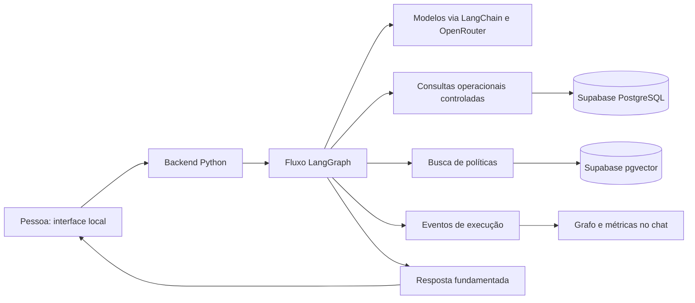

# Empório da Música — planejamento do desafio Artefact

> Documento de planejamento inicial | Atualizado em 31/10/2026  
> Situação: preservei as decisões do planejamento; a implementação e a execução local estão descritas no README e em `docs/avaliacao.md`.

## 1. Objetivo

Construir um protótipo de atendimento textual para a loja fictícia Empório da Música, baseado nos dados e políticas fornecidos no desafio. A solução deve ser clara, executável localmente e fácil de explicar em entrevista.

O agente deve atender com cordialidade, consultar dados para perguntas operacionais, recuperar trechos do manual para perguntas de políticas, combinar fontes quando necessário e reconhecer perguntas fora do escopo ou informações insuficientes.

O prazo informado para desenvolvimento e testes é de **dois dias**. A prioridade é um fluxo completo e confiável, com código Python legível, testes relevantes e documentação reproduzível.

## 2. Requisitos do desafio e entrega

- Python como linguagem principal do projeto.
- Repositório Git público, com histórico de commits que represente o progresso real.
- README com instruções de execução e configuração, decisões técnicas, limitações e descrição de como a IA foi utilizada no desenvolvimento.
- De três a cinco conversas de exemplo, pelo menos uma não trivial, baseadas em execuções reais.
- Respeitar o prazo comunicado pela Artefact e não alterar o repositório após a data e o horário de entrega.
A execução local será documentada para tornar a solução reproduzível. Não há hospedagem ou link público da aplicação no escopo.

## 3. Decisões já alinhadas

| Tema | Decisão |
|---|---|
| Prazo | Dois dias para desenvolvimento e testes. |
| Linguagem principal | Python, concentrando a lógica do agente, dados e integrações. |
| Orquestração | LangGraph, com fluxo pequeno e explícito. |
| Integração com modelos | LangChain e OpenRouter; modelos configuráveis e selecionados após teste. |
| Dados | Supabase PostgreSQL para os CSVs e pgvector para o PDF de políticas. |
| Interface | Interface local simples, com visualização do fluxo e indicadores disponíveis. |
| Avaliação | Execução local e repositório público conforme o desafio. |
| Pedidos | Sem autenticação na primeira versão; não revelar dados individuais de clientes ou pedidos, inclusive status e rastreamento. |
| Custos | Há saldo no OpenRouter. Controlar e apresentar consumo de modelos e embeddings quando disponível; o valor exato de orçamento não foi definido. |
| Documentação | README e documentos Markdown objetivos, atualizados conforme as decisões reais. |

**Grafo — hipótese a confirmar:** mostrar o caminho efetivamente percorrido ao final de cada resposta. A resposta recebida sobre o momento de exibição admite mais de uma interpretação; caso o desejado seja acompanhamento durante a execução, será necessário ajustar a interface, o streaming e a estimativa de esforço.

## 4. Arquitetura proposta

O backend controla a execução, valida os dados recebidos e chama funções de leitura autorizadas. A aplicação deve proteger credenciais e usar uma identidade de banco com permissões mínimas de leitura.

A aplicação será executada localmente; o formato exato da interface será escolhido pela simplicidade e justificado no README.

### Fluxo inicial

1. Receber a pergunta e o contexto recente necessário.
2. Identificar a intenção e os dados necessários.
3. Encaminhar para consultas operacionais, busca de políticas, ambas ou resposta fora de escopo.
4. Validar os resultados e responder com base nas evidências disponíveis.
5. Registrar eventos reais para apresentar o caminho, tempo, fontes e uso informado.

O fluxo deve poder pedir esclarecimentos quando faltar informação. Em situações híbridas, os passos utilizados dependerão da pergunta e da autorização disponível. Não são necessárias múltiplas chamadas de modelo em todos os turnos.

## 5. LangGraph, LangChain e OpenRouter

- **LangGraph:** definir estado, nós e caminhos do atendimento. Cada nó deve ter responsabilidade clara e poder ser testado.
- **LangChain:** integrar modelos e estruturar mensagens e resultados quando simplificar a implementação.
- **OpenRouter:** provedor de acesso aos modelos. Avaliar a integração `langchain-openrouter`, fixar versões compatíveis e testar as capacidades dos modelos realmente escolhidos.
- Começar com um modelo configurável; acrescentar modelos ou papéis somente se os testes demonstrarem benefício.
- Limitar histórico, tamanho das respostas, tentativas e chamadas por turno para controlar latência e gastos.
- Tratar dados externos e conteúdo recuperado como evidências não confiáveis, nunca como instruções privilegiadas.

O Codex pode auxiliar no desenvolvimento e revisão; seu uso será declarado no README. O Codex SDK não é uma dependência obrigatória do agente de atendimento.

## 6. Dados operacionais

Os arquivos foram inspecionados inicialmente; os totais abaixo são contagens de registros de dados, ainda sujeitas à validação de integridade.

| Arquivo | Registros | Colunas |
|---|---:|---|
| categories | 9 | category_id, name, description |
| customers | 50 | customer_id, name, phone, email, city |
| products | 65 | product_id, price_brl, name, category_id, description, stock_quantity, status, specs, created_at |
| orders | 20 | order_id, customer_id, order_date, status, total_brl, payment_method, tracking_code, estimated_delivery, notes |
| order_items | 22 | order_id, quantity, product_id |
| promotions | 25 | promotion_id, product_id, discount_percent, description, is_active |

A ingestão deve preservar identificadores, examinar tipos, nulos, duplicatas e relacionamentos, e produzir um relatório de inconsistências. O esquema do Supabase será definido a partir dos dados efetivos. As tabelas serão carregadas de forma reproduzível; a disponibilidade, preços e promoções representam o **snapshot fornecido**, não um sistema de loja atualizado em tempo real.

As consultas de atendimento devem ser parametrizadas e limitadas a operações de leitura e campos necessários. O modelo pode propor filtros estruturados, mas Python controla e valida a execução. O indicador `is_active` das promoções é parte do snapshot: não há datas de vigência no arquivo, portanto não se deve afirmar que houve verificação de validade por período.

### Pedidos e privacidade

O responsável determinou que dados individuais de clientes e pedidos só podem ser consultados com autenticação e autorização. Como a primeira versão não prevê autenticação, o agente deve bloquear a consulta de status, rastreamento e outros dados individuais e orientar o atendimento apropriado.

Os seis arquivos podem ser carregados para modelagem no schema `artefact`, mas o agente de atendimento não pode consultar ou revelar dados individuais de clientes e pedidos sem autenticação e autorização. O responsável autorizou a publicação dos materiais fornecidos; credenciais e dados de outros projetos não devem ser expostos.

## 7. Políticas e RAG

O manual fornecido possui oito páginas. A proposta é extrair o texto com referência de página e seção, separar trechos preservando o contexto das regras, gerar embeddings e armazená-los no pgvector. Na pergunta, recuperar trechos relevantes e fornecer ao modelo apenas as evidências necessárias. A resposta deve indicar fonte e página quando aplicável e reconhecer ausência ou conflito de informação.

A escolha do modelo de embeddings considerou custo, compatibilidade com o pgvector e qualidade em português. Confirmar se o modelo escolhido está acessível pelo provedor pretendido; se exigir outra API ou execução local, documentar credenciais, custos e operação. A dimensão do vetor no banco deve corresponder ao modelo efetivamente utilizado.

### Ambiguidades para avaliação

- A página 3 apresenta uma condição geral de parcelamento e regras específicas por faixa; preservar as duas ao responder.
- A página 4 menciona procedimento para defeitos após 30 dias e a página 7 descreve garantia legal de 90 dias. Não apresentar uma interpretação categórica quando a aplicação ao caso não estiver clara.
- O manual apresenta números de contato diferentes em seções distintas. Não selecionar um arbitrariamente quando a diferença for relevante.
- Para devolução, não há coluna identificada de data efetiva de recebimento nos pedidos. Não concluir elegibilidade individual sem os fatos necessários.

O agente deve citar o manual como fonte da política da loja, reconhecer conflitos e orientar confirmação humana quando necessário.

## 8. Interface e rastreabilidade

A interface local deve apresentar:

- Chat acessível e simples, com estado de carregamento e mensagens de erro compreensíveis.
- Fontes e páginas das políticas quando usadas.
- Grafo ou sequência visual gerada a partir dos **eventos efetivos** daquela resposta, incluindo caminhos não percorridos somente se estiverem claramente identificados.
- Para cada etapa disponível: nome, estado, duração, ferramenta ou modelo e erro sem dados sensíveis.
- Indicadores de uso de tokens e custo por chamada, por resposta e por conversa, quando os dados forem fornecidos.

O desenho inicial presume exibição ao final de cada resposta; exibição durante a execução permanece sujeita à confirmação. O LangGraph não fornece automaticamente a visualização: a aplicação precisa emitir eventos e a interface precisa apresentá-los.

Evitar armazenar mensagens e dados pessoais por padrão. Se persistência for necessária, definir finalidade, retenção, acesso e remoção. Telemetria de diagnóstico deve minimizar informações sensíveis.

## 9. Controle de custos

- Configurar modelos, limites de tokens, quantidade de chamadas e histórico por variáveis de ambiente.
- Registrar uso informado pelo provedor e identificadores de chamada quando disponíveis.
- Distinguir custo informado pelo provedor de custo estimado; quando estimado, registrar tarifa e data de referência. Se indisponível, apresentar “não informado”.
- Considerar embeddings, indexação, modelos e banco separadamente quando houver informação para isso.
- Definir limites de chamadas e consumo, além de tratamento para erros, esgotamento de saldo e indisponibilidade.
- Conferir os limites efetivos das contas e os recursos de controle disponíveis durante a execução. Monitorar o saldo e o consumo no OpenRouter; limites da aplicação não garantem, isoladamente, um teto absoluto de cobrança.

Não há valor máximo de orçamento acordado. Evitar estimar um teto sem definição do responsável pela conta.

## 10. Qualidade e testes

Avaliar, no mínimo:

1. Pesquisa de produtos por categoria, preço, status e estoque com base nos dados importados.
2. Consulta de políticas com página correta e resposta que reconheça ausência de evidência.
3. Combinação de dados e política, incluindo promoção e condições de pagamento quando os dados permitirem.
4. Pedido individual bloqueado sem autenticação, inclusive em perguntas híbridas.
5. Pergunta fora do escopo, pedido ambíguo e tentativa de instrução maliciosa em conteúdo externo.
6. Consistência entre eventos mostrados no grafo e o fluxo executado; indicação honesta de métricas ausentes.
7. Verificação da aplicação local, de erros esperados e dos limites de uso.

As três a cinco conversas entregues devem ser transcrições reais, com cenários variados e pelo menos um caso não trivial. Registrar limitações identificadas, sem inventar resultados.

## 11. Documentação prevista

- `README.md`: objetivo, execução, configuração, arquitetura resumida, decisões, limitações e uso de assistentes de código.
- `docs/arquitetura.md`: fluxo, componentes, responsabilidades e alternativas consideradas.
- `docs/dados-e-rag.md`: esquema, ingestão, verificações, origem e limitações dos dados e do manual.
- `docs/avaliacao.md`: critérios, testes, resultados e limitações observadas.
- `examples/`: três a cinco conversas reais em Markdown.
- `.env.example`: nomes de variáveis necessários, sem segredos.

A estrutura final pode ser simplificada se um único README e poucos arquivos forem suficientes. Documentar o que for efetivamente implementado e verificado.

## 12. Decisões registradas na execução

1. Exibo o caminho efetivamente percorrido ao final da resposta, em uma interface local.
2. Limitei chamadas, histórico, tamanho e turnos; mostro o custo informado, sem prometer teto absoluto de cobrança. Não foi definido orçamento total fixo.
3. Validei `gpt-4.1-mini` e embeddings `text-embedding-3-small` com 1.536 dimensões pelo OpenRouter.
4. O responsável informou o prazo de 02/11/2026 às 00:00, interpretado no horário de Brasília. Não alterarei o repositório após esse limite.

## 13. Referências

- [LangGraph e LangChain — documentação](https://docs.langchain.com/oss/python/learn)
- [OpenRouter — integração LangChain](https://openrouter.ai/blog/tutorials/langchain-chatopenrouter-setup/)
- [OpenRouter — uso e cobrança](https://openrouter.ai/support)
- [Supabase — pgvector](https://supabase.com/docs/guides/database/extensions/pgvector)

Os arquivos originais do desafio e das políticas permanecem como fontes primárias do projeto. Implementei as tabelas, a indexação, o agente e as interfaces locais. Os resultados e limitações estão no README e em `docs/avaliacao.md`.
