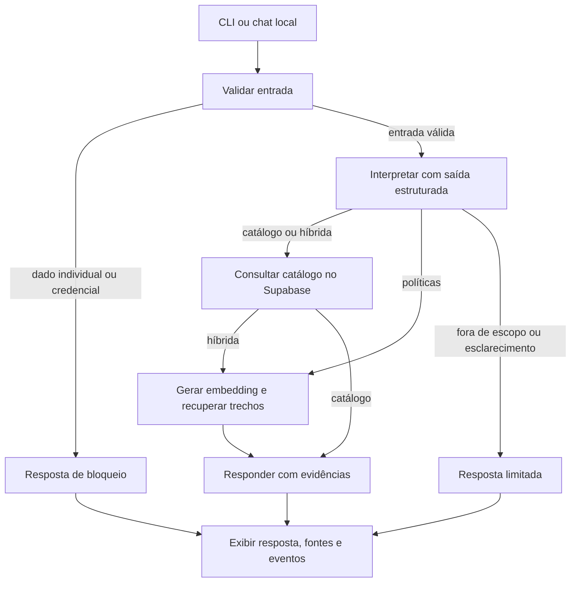

# Como organizei o agente

Usei Python para a aplicação inteira. Separei a preparação administrativa do atendimento
para que o modelo não receba uma conexão com acesso amplo ao banco.

O fluxo real está em `src/emporio/agent.py`. Não implementei ciclos autônomos: cada turno
faz no máximo uma interpretação e uma redação pelo modelo. Quando preciso de políticas,
faço uma chamada adicional de embeddings. Bloqueios e respostas controladas podem reduzir
a quantidade de chamadas. Uma falha encerra aquele caminho com mensagem compreensível.

- `config.py`: leio variáveis locais sem imprimir segredos.
- `models.py`: valido plano, eventos e retorno com Pydantic.
- `ingest.py`: valido CSVs, preparo tabelas, indexo o manual e crio o login restrito.
- `store.py`: executo SQL parametrizado e leitura vetorial com timeout.
- `provider.py`: integro OpenRouter e registro uso informado; filtro instruções suspeitas.
- `policies.py`: preservo conflitos conhecidos e evito inferir fatos individuais.
- `cli.py` e `app.py`: exponho a mesma lógica no terminal e no navegador local.

Escolhi consultas controladas em vez de um agente que escreva SQL livre. O modelo decide
filtros dentro de um contrato, mas Python executa somente consultas predefinidas.
Não usei um conjunto de agentes ou uma cadeia longa de modelos porque o escopo não exigiu.

Os eventos exibidos vêm das funções efetivamente executadas. A geração mostra o modelo,
tokens e custo quando disponíveis. Os eventos de validação e banco têm duração e estado,
mas não atribuo consumo de modelo a eles. Registro um erro sanitizado quando uma etapa falha.

Mantive o histórico apenas na sessão local. O agente não tem checkpointer, banco de
conversas, autenticação ou acesso individual a pedidos. A persona usa o tom definido no
manual; a documentação e os commits descrevem meu trabalho em primeira pessoa.
